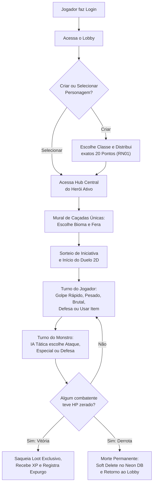
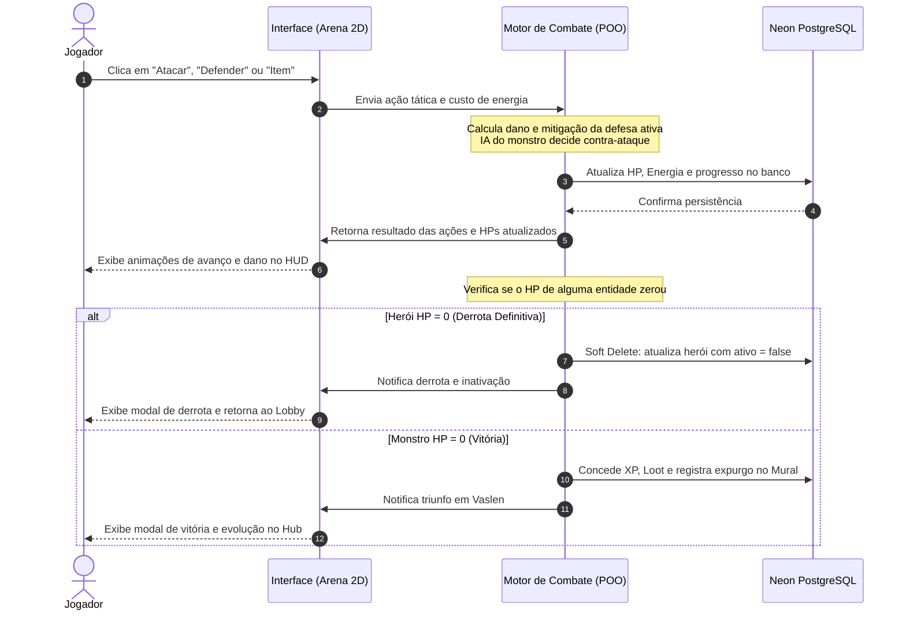

# Fracture: The Vaslen Echoes — Documento Consolidado de Entregas

Este documento reúne de forma contínua e consolidada todas as atividades e entregas de desenvolvimento do sistema web **Fracture: The Vaslen Echoes** para a disciplina de Programação Orientada a Objetos (POO).

---

# Atividade 1 — Descrição do Projeto

### Nome do Sistema
**Fracture: The Vaslen Echoes**

### Área de Atuação
Desenvolvimento de Software, Jogos Digitais e Aplicações Web Interativas.

---

### Descrição do Problema
O ensino e aprendizado prático de Programação Orientada a Objetos (POO) em nível universitário costuma ser pautado em sistemas de informação administrativos tradicionais, como controle de vendas, cadastros de clientes ou gestão de frotas. Embora úteis, esses temas falham em ilustrar de forma orgânica e empolgante o uso de mecânicas de estado em tempo real e comportamentos polimórficos ricos. 

Além disso, há uma escassez de exemplos práticos que integrem de forma harmônica a orientação a objetos robusta com tecnologias web e persistência em banco de dados, sem cair na simplicidade de operações de CRUD básicas (criação, leitura, atualização e exclusão sem regras de domínio significativas).

### Descrição da Solução Proposta
A solução consiste no desenvolvimento de um jogo de RPG de batalhas por turnos baseado em navegador (Web App) com estética de fantasia medieval sombria e arte retrô em pixel art 2D. O jogo utiliza os pilares de POO para gerenciar a lógica complexa de combate, economia de energia e estados. 

As entidades do jogo (heróis, classes, monstros, chefes e efeitos de status) são modeladas utilizando conceitos de **Herança e Polimorfismo** (como a classe abstrata `EntidadeCombatente` especializada em `Personagem` e `Monstro`, e a classe `Item` especializada em `ItemComposto`). As fórmulas matemáticas de combate e mitigação por postura defensiva são protegidas através de **Encapsulamento**, e as regras de negócio de morte do personagem são integradas diretamente à persistência do banco de dados relacional **Neon Cloud PostgreSQL**, implementando exclusão lógica (**Soft Delete**) de forma a agregar consequências reais e permanência à jogabilidade.

### Público-alvo
*   Estudantes e entusiastas de engenharia de software e programação orientada a objetos interessados em modelagem de domínio rica.
*   Jogadores casuais de RPGs táticos e jogos de combate por turnos que apreciam desafios estratégicos e ambientação medieval sombria.

### Objetivo Geral do Sistema
Prover uma plataforma web dinâmica, interativa e envolvente na qual os jogadores criem personagens, distribuam atributos estrategicamente, enfrentem criaturas e chefes em combate tático por turnos ao longo dos 7 Biomas do Arquipélago da Fratura, gerenciem seus itens e elixires, evoluam seu nível através do acúmulo de experiência, enquanto experimentam as consequências definitivas de suas ações (morte permanente regulada por banco de dados com Soft Delete).

---

### Principais Funcionalidades
1.  **Autenticação de Usuários**: Cadastro de conta, login seguro com criptografia `bcrypt`, emissão de tokens JWT e controle de acesso a rotas protegidas.
2.  **Lobby de Personagens**: Exibição dos personagens ativos da conta e opção de desativação manual (Soft Delete).
3.  **Criação Personalizada**: Sistema de criação de personagens com escolha de classe (`GUERREIRO`, `MAGO` ou `SAMURAI`), atribuição de consumível inicial característico e validação matemática obrigatória no servidor de exatamente 20 pontos de atributos iniciais (RN01) para evitar trapaças.
4.  **Hub Central e Evolução**: Exibição detalhada de status, inventário de consumíveis/relíquias e evolução de nível do herói com distribuição de novos pontos de atributos permanentes.
5.  **Mural de Caçadas Únicas (Anti-Farm)**: Mapa mundi em pixel art 16-bit com 7 biomas e 21 monstros únicos. Cada fera só pode ser expurgada uma única vez pelo herói, concedendo loot exclusivo e XP.
6.  **Códice de Vaslen**: Enciclopédia arcana ligada ao banco de dados Neon contendo 40 verbetes divididos em História/Crônicas, Biomas/Regiões, Bestiário Completo (com sprites animados dos 21 monstros e atributos) e Tratado de Relíquias (com ícones em pixel art 16x16 de todos os itens).
7.  **Motor de Combate por Turnos**: Sistema de batalha em tempo real simulado entre o herói e um monstro, com sorteio de iniciativa, economia tática de energia (Ataque Rápido, Pesado, Brutal Quebra-Guarda e Postura Defensiva) e uso de consumíveis da mochila.
8.  **Consequência de Morte**: Sistema automatizado de derrota que inativa de forma permanente o personagem no banco de dados após sua vida chegar a zero (Soft Delete).

---

### Descrição do Processo Principal
O processo de jogo segue o seguinte fluxo linear:

1.  **Acesso**: O jogador realiza o login ou cadastro para acessar a lista de personagens ativos da sua conta.
2.  **Criação/Seleção**: O jogador seleciona um personagem existente ou cria um novo, escolhendo entre as classes `GUERREIRO`, `MAGO` ou `SAMURAI` e distribuindo obrigatoriamente 20 pontos iniciais em seus atributos (recebendo um item inicial na mochila).
3.  **Mural e Expedição**: O jogador abre o Mural dos 7 Biomas de Vaslen e desafia uma das 21 criaturas disponíveis (o sistema impede combates repetidos contra monstros já derrotados pelo herói).
4.  **Duelo de Turnos**: O combate inicia com um sorteio de iniciativa. No seu turno, o jogador gasta energia para desferir golpes rápidos, pesados, brutais que quebram guarda, assumir postura defensiva para recuperar energia ou consumir itens da mochila. Em seguida, a IA do monstro decide sua ação com base na postura do herói e sua reserva de energia.
5.  **Desfecho**:
    *   **Vitória**: Se o HP do monstro zerar primeiro, o herói recebe XP, saqueia o item de loot da criatura e registra a vitória no Mural (Anti-Farm). Caso suba de nível, ele pode distribuir pontos extras no Hub Central.
    *   **Derrota**: Se o HP do herói zerar, ocorre a **derrota definitiva**. O sistema altera o status do personagem no banco de dados para inativo (`ativo = false`, Soft Delete). O herói é retirado da lista de seleção ativa do jogador, restando ao usuário criar ou selecionar outro personagem no Lobby.

---

### Justificativa para a Escolha do Tema
A escolha de um RPG medieval sombrio de batalhas por turnos se justifica pela perfeita aderência entre a temática do jogo e os requisitos pedagógicos e técnicos da disciplina de Programação Orientada a Objetos. 

Em sistemas web tradicionais, o comportamento polimórfico costuma se limitar a pequenos detalhes cadastrais, enquanto em um RPG de combate, heróis, monstros e itens possuem comportamentos e reações radicalmente diferentes que se beneficiam diretamente de classes abstratas (`EntidadeCombatente`), interfaces, herança polimórfica (`ItemComposto`) e orquestração desacoplada de serviços (`MotorCombate`). Além disso, a aplicação de regras matemáticas restritas na criação (RN01) e a mecânica de morte permanente (Soft Delete com Prisma ORM e Neon PostgreSQL) demonstram a robustez necessária na integração entre o back-end, banco de dados e a experiência final no front-end web.

---

# Atividade 2 — Levantamento dos Requisitos

## Perfis de Usuário e Permissões

O sistema possui dois perfis distintos de usuários autenticados para garantir o acesso adequado às funcionalidades:

### 1. Jogador (Player)
Perfil padrão destinado aos usuários que interagem com a jogabilidade e progressão.
*   **Permissões**:
    *   Cadastrar conta e realizar login/logout seguro com JWT.
    *   Criar personagens vinculados à sua conta (escolhendo classe e distribuindo atributos iniciais).
    *   Visualizar e selecionar personagens ativos em seu Lobby.
    *   Inativar manualmente seus personagens (Soft Delete).
    *   Navegar pelo Mural dos 7 Biomas e iniciar duelos contra criaturas disponíveis.
    *   Realizar ações táticas no motor de batalha por turnos (Ataque Rápido, Pesado, Brutal, Defesa e Usar Itens).
    *   Evoluir personagens distribuindo novos pontos de atributos após subir de nível.
    *   Consultar histórias, biomas, fichas de monstros com sprites e relíquias com ícones no Códice de Vaslen.

### 2. Administrador (Admin)
Perfil com acesso ao controle, manutenção e balanceamento do jogo.
*   **Permissões**:
    *   Todas as permissões do perfil de Jogador.
    *   Gerenciar o Códice de Vaslen (criar, editar e semear termos de lore, guias e monstros).
    *   Configurar e balancear criaturas e chefes do jogo (HP, Força, Defesa, Agilidade, Loots).
    *   Acessar relatórios e dados do sistema no banco de dados.

---

## Requisitos Funcionais (RF)

| Código | Requisito | Descrição |
| :--- | :--- | :--- |
| **RF01** | Cadastro de Contas | O sistema deve permitir que novos usuários criem contas informando e-mail e senha. |
| **RF02** | Autenticação (Login) | O sistema deve autenticar o usuário gerando token JWT e assegurar que rotas internas do jogo exijam sessão válida. |
| **RF03** | Criação de Personagens | O sistema deve permitir ao Jogador criar novos personagens escolhendo um nome, uma classe (`GUERREIRO`, `MAGO` ou `SAMURAI`) e conceder um item inicial correspondente. |
| **RF04** | Validação de Atributos | O sistema deve validar no servidor que a soma dos atributos iniciais (Força, Defesa e Agilidade) seja exatamente igual a 20. |
| **RF05** | Lobby de Seleção | O sistema deve exibir para o Jogador autenticado a lista de seus personagens que estão ativos (`ativo = true`) no banco de dados. |
| **RF06** | Inativação Manual | O sistema deve permitir ao Jogador desativar manualmente qualquer personagem (Soft Delete), removendo-o da listagem do Lobby. |
| **RF07** | Motor de Combate (Turnos) | O sistema deve gerenciar uma batalha sequencial de turnos com sorteio de iniciativa entre o herói e a criatura desafiada. |
| **RF08** | Ações Táticas do Jogador | O sistema deve permitir que o Jogador execute ações com custos reais de energia: Golpe Rápido (10 EN), Pesado (18 EN), Brutal Quebra-Guarda (26 EN), Defender (+30% EN e mitigação de dano) e Usar Item da Mochila. |
| **RF09** | Inteligência Artificial do Inimigo | O sistema deve processar a ação automatizada do monstro com base em sua reserva de energia, postura do herói e sem repetição consecutiva de golpes. |
| **RF10** | Mural de Caçadas Únicas (Anti-Farm) | O sistema deve rastrear os monstros derrotados por cada herói e bloquear desafios repetidos contra feras já expurgadas. |
| **RF11** | Evolução de Nível (XP) | O sistema deve conceder XP e loot exclusivo ao personagem após a vitória, permitindo redistribuição de novos pontos de atributos no Hub Central. |
| **RF12** | Derrota e Soft Delete | O sistema deve inativar permanentemente no banco de dados (`ativo = false`) o personagem cuja vida for reduzida a zero no combate. |
| **RF13** | Códice Ilustrado de Vaslen | O sistema deve fornecer uma interface de pesquisa textual com filtros por categoria (`HISTORIA`, `REGIAO`, `MONSTRO`, `RELÍQUIA`), exibindo sprites animados nas criaturas e ícones pixel art nos consumíveis. |

---

## Requisitos Não Funcionais (RNF)

| Código | Requisito | Descrição |
| :--- | :--- | :--- |
| **RNF01** | Responsividade e Interface Pixel Art | A interface web do sistema deve ser renderizada em estética retrô 16-bit com layout responsivo para desktops, tablets e celulares. |
| **RNF02** | Segurança de Senhas e Sessão | O sistema deve armazenar senhas com hash criptográfico `bcrypt` e proteger endpoints RESTful com tokens `JWT (Bearer)`. |
| **RNF03** | Tempo de Resposta | O tempo médio de processamento e persistência das ações de combate e turnos deve ser inferior a 300 milissegundos. |
| **RNF04** | Portabilidade de Navegador | O sistema deve ser compatível e renderizar de forma consistente em todos os navegadores modernos (Edge, Chrome, Firefox, Safari). |
| **RNF05** | Persistência Relacional em Nuvem | Os dados de usuários, heróis, inventários, vitórias no mural e códice devem ser persistidos no banco relacional Neon Cloud PostgreSQL através do Prisma ORM. |

---

## Regras de Negócio (RN)

| Código | Regra | Descrição |
| :--- | :--- | :--- |
| **RN01** | Distribuição Obrigatória de Pontos | A soma dos atributos de criação (`Força + Defesa + Agilidade`) deve totalizar **exatamente 20 pontos** iniciais. Qualquer valor diferente deve ser rejeitado pelo construtor da classe no back-end. |
| **RN02** | Atributos Mínimos | Nenhum atributo de personagem ou monstro (HP, Força, Defesa, Agilidade) poderá conter valor negativo ou igual a zero na criação. |
| **RN03** | Inativação Automática (Morte) | Quando o HP do personagem chegar a zero durante a batalha, o sistema deve marcar o atributo `ativo` do registro no banco de dados como `false` (Soft Delete imediato). |
| **RN04** | Acesso a Personagens Inativos | Registros de personagens com `ativo = false` não podem ser listados no Lobby de seleção nem ter seu estado alterado de volta para ativo. |
| **RN05** | Fórmula de Mitigação e Dano Mínimo | O dano bruto considera a força e o multiplicador do golpe (`1.0x`, `1.8x`, `2.5x`). O dano real deduz a mitigação da defesa passiva do alvo e reduz 45% se o defensor assumiu postura de guarda (ou 20% caso o atacante use Ataque Brutal Quebra-Guarda). O dano mínimo garantido é sempre de 1 ponto. |
| **RN06** | Iniciativa de Combate | A iniciativa do primeiro turno é determinada em sorteio visual dinâmico. Se o monstro for sorteado, ele executa seu golpe de abertura antes de liberar a vez do jogador. |
| **RN07** | Escalonamento de Experiência (XP) | O limite de experiência para subir de nível é calculado progressivamente pela fórmula `XP_Necessário = Nível_Atual * 100`. |
| **RN08** | Anti-Farm do Mural de Caçadas | Um herói não pode desafiar novamente um monstro cujo identificador já conste em sua lista de `monstrosDerrotados`. |
| **RN09** | Confirmação de Level Up | O personagem que subir de nível recebe 3 pontos livres para distribuição permanente no Hub Central entre Força, Defesa ou Agilidade. |
| **RN10** | Consumo Imediato de Itens | Ao usar um consumível na mochila durante a batalha, seus efeitos de HP, Energia ou Dano são aplicados imediatamente e o item é removido do inventário persistido no banco de dados. |

---

## Descrição Detalhada do Processo Principal

O processo principal de **Fracture: The Vaslen Echoes** consiste no **Ciclo de Combate por Turnos, Gestão Tática e Suas Consequências**.

### Diagrama de Sequência de Combate

---

# Atividade 3 — Identificação das Classes

Nesta etapa são identificadas e modeladas as principais classes que compõem o domínio de **Fracture: The Vaslen Echoes**. Cada classe foi projetada com base nos princípios de **Abstração**, **Encapsulamento**, **Herança** e **Polimorfismo**, respeitando a convenção de nomenclatura em **Português do Brasil (PT-BR)**.

---

### Conceitos Relacionados à Modelagem
*   **Abstração**: Separação das características essenciais das entidades do jogo (como pontos de vida e combate) dos detalhes técnicos de infraestrutura ou renderização.
*   **Classe**: Molde/estrutura que define os atributos e comportamentos de uma entidade (ex: a classe `Personagem`).
*   **Objeto / Instância**: A materialização concreta de uma classe na memória durante a execução (ex: um guerreiro específico chamado "Valerius", que é uma instância da classe `Personagem`).
*   **Atributos**: As variáveis que armazenam o estado interno do objeto (ex: `vidaAtual`, `forca`, `energiaAtual`).
*   **Métodos**: As funções/ações que manipulam o estado interno e definem o comportamento do objeto (ex: `atacar()`, `receberDano()`, `defender()`).

---

## Detalhamento das Classes do Domínio

### 1. Classe `Usuario`
*   **Finalidade**: Representar a conta de acesso e identidade do usuário autenticado no sistema.
*   **Responsabilidade**: Gerenciar os dados cadastrais, credenciais de acesso, perfil de permissão (Jogador ou Administrador) e a coleção de personagens criados vinculados à sua conta.
*   **Atributos**:
    *   `id`: Identificador único da conta.
    *   `email`: Endereço de e-mail utilizado para login.
    *   `senhaHash`: Hash criptográfico da senha de acesso (`bcrypt`).
    *   `tipoUsuario`: Perfil do usuário (`JOGADOR` ou `ADMINISTRADOR`).
    *   `dataCriacao`: Data e hora em que a conta foi criada.
    *   `personagens`: Coleção de heróis do tipo `Personagem` pertencentes ao usuário.
*   **Métodos**:
    *   `autenticar(senhaInformada)`: Valida a senha contra o hash criptográfico.
    *   `adicionarPersonagem(personagem)`: Vincula um novo herói criado à conta.
    *   `inativarPersonagem(idPersonagem)`: Executa a inativação lógica (Soft Delete) de um herói.
    *   `listarPersonagensAtivos()`: Retorna apenas os personagens com `ativo = true`.

---

### 2. Classe Abstrata `EntidadeCombatente`
*   **Finalidade**: Servir como classe base abstrata para todos os seres capazes de batalhar no jogo (`Personagem` e `Monstro`).
*   **Responsabilidade**: Encapsular os atributos vitais e de combate fundamentais, fornecendo métodos universais para recebimento de dano com mitigação, gestão de energia, recuperação de vida e postura defensiva.
*   **Atributos**:
    *   `id`: Identificador único da entidade.
    *   `nome`: Nome da entidade.
    *   `nivel`: Nível atual de poder da entidade.
    *   `vidaMaxima`: Quantidade máxima de pontos de vida (HP).
    *   `vidaAtual`: Quantidade atual de pontos de vida durante o combate.
    *   `energiaMaxima`: Capacidade máxima da reserva de energia.
    *   `energiaAtual`: Quantidade atual de energia disponível para manobras de ataque.
    *   `forca`: Atributo base que determina o poder de ataque físico.
    *   `defesa`: Atributo base que determina a mitigação passiva de dano.
    *   `agilidade`: Atributo que determina iniciativa e precisão.
    *   `estadoDefesa`: Indicador booleano de postura de guarda ativa no turno.
    *   `modificadorDano`: Bônus temporário de ataque conferido por óleos e relíquias.
*   **Métodos**:
    *   `atacar(alvo, multiplicadorDano)`: Executa o golpe aplicando a fórmula de dano bruto e somando bônus de óleos/relíquias.
    *   `receberDano(valorAtaque, forcaAtacante)`: Aplica a fórmula de mitigação passiva e postura defensiva, retornando o dano líquido sofrido.
    *   `defender()`: Ativa a guarda reforçada e restaura energia (`max(25, 30% da Energia Máxima)`).
    *   `curarVida(quantidade)`: Restaura pontos de vida respeitando `vidaMaxima`.
    *   `recuperarEnergia(quantidade)`: Restaura energia respeitando `energiaMaxima`.
    *   `gastarEnergia(quantidade)`: Deduz energia com validação de saldo suficiente.
    *   `estaDerrotado()`: Retorna verdadeiro caso `vidaAtual <= 0`.
    *   `executarAcaoEspecial(alvo)`: Método abstrato que obriga cada subclasse a implementar sua manobra suprema (Polimorfismo).

---

### 3. Classe `Personagem` (Herda de `EntidadeCombatente`)
*   **Finalidade**: Representar o herói criado e controlado pelo jogador dentro do RPG.
*   **Responsabilidade**: Controlar a especialização da classe (`GUERREIRO`, `MAGO` ou `SAMURAI`), progressão de experiência (XP), mochila de itens (`Item[]`), lista de monstros derrotados no mural e estado ativo.
*   **Atributos**:
    *   *(Herda todos os atributos de `EntidadeCombatente`)*
    *   `classeHeroi`: Especialização do herói (`GUERREIRO`, `MAGO` ou `SAMURAI`).
    *   `experienciaAtual`: Quantidade de pontos de experiência acumulados.
    *   `experienciaNecessaria`: Total de XP necessário para alcançar o próximo nível.
    *   `pontosLivres`: Pontos de atributo disponíveis para distribuição após subir de nível.
    *   `ativo`: Indicador booleano de Soft Delete (`true` = ativo, `false` = derrotado/excluído).
    *   `idUsuario`: Chave estrangeira que referencia a conta proprietária.
    *   `inventario`: Coleção de instâncias polimórficas de `Item` que o herói carrega.
    *   `monstrosDerrotados`: Lista de IDs de monstros já expurgados pelo herói (Mural Anti-Farm).
*   **Métodos**:
    *   *(Herda os métodos de `EntidadeCombatente`)*
    *   `ataque(alvo, tipoAtaque)`: Executa ataques táticos: Golpe Rápido (10 EN [1.0x]), Pesado (18 EN [1.8x]) ou Brutal Quebra-Guarda (26 EN [2.5x]).
    *   `usarItemDoInventario(indice, alvo)`: Aplica o efeito do item do inventário e o remove da mochila.
    *   `adicionarItemAoInventario(item)`: Insere um novo consumível ou relíquia saqueada na mochila.
    *   `ganharExperiencia(quantidade)`: Adiciona XP e aciona automaticamente a subida de nível quando a meta é alcançada.
    *   `subirNivel()`: Incrementa o nível, concede 3 pontos livres e amplia HP e Energia máximos.
    *   `distribuirPontos(forcaAdd, defesaAdd, agilidadeAdd)`: Adiciona os pontos livres aos atributos permanentes do herói.
    *   `jaDerrotouMonstro(idMonstro)`: Verifica se o monstro já foi derrotado anteriormente pelo herói.
    *   `registrarVitoriaContraMonstro(idMonstro)`: Registra o monstro na lista de vitórias do herói.
    *   `executarAcaoEspecial(alvo)`: Sobrescrita polimórfica que executa a técnica suprema da classe (ex: *Golpe Devastador* para Guerreiro, *Explosão Arcana* para Mago, *Corte do Eclipse* para Samurai).

---

### 4. Classe `Monstro` (Herda de `EntidadeCombatente`)
*   **Finalidade**: Representar as criaturas e chefes do reino de Vaslen enfrentados pelo jogador.
*   **Responsabilidade**: Definir o padrão de inteligência artificial de combate, recompensas de experiência, loot concedido e descrições canônicas de lore.
*   **Atributos**:
    *   *(Herda todos os atributos de `EntidadeCombatente`)*
    *   `tipoMonstro`: Categoria da criatura (`COMUM`, `ELITE` ou `CHEFE`).
    *   `experienciaConcedida`: Quantidade de XP concedida ao herói vitorioso.
    *   `bioma`: Região de Vaslen à qual a criatura pertence (`CRIPTAS`, `BOSQUE_SOMBRIO`, `LABIRINTO_CINZAS`, etc.).
    *   `itemRecompensa`: Instância de `Item` que a fera concede como saque exclusivo ao ser expurgada.
    *   `descricaoLore`: Texto descritivo sobre as características da criatura.
    *   `ultimoGolpe`: Memória da última ação executada para evitar repetições monótonas de ataques.
*   **Métodos**:
    *   *(Herda os métodos de `EntidadeCombatente`)*
    *   `decidirAcao(alvo)`: Algoritmo de IA tática que avalia a postura do herói, cooldown de habilidades especiais e reserva de energia para alternar dinamicamente entre ataques rápidos, pesados, brutais, especiais e postura defensiva.
    *   `getItemRecompensa()`: Retorna o item de loot configurado para a criatura.
    *   `executarAcaoEspecial(alvo)`: Sobrescrita polimórfica que executa o golpe de chefe característico da fera (ex: *Fúria Selvagem*, *Ataque de Elite*, *Golpe Devastador*).

---

### 5. Classes `Item` e `ItemComposto` (Polimorfismo de Itens)
*   **Finalidade**: Modelar os consumíveis, óleos de combate e relíquias que compõem o sistema de recompensas e mochila do jogo.
*   **Responsabilidade**: Encapsular o efeito benéfico ao ser utilizado em uma `EntidadeCombatente`.
*   **Atributos da Classe Base `Item`**:
    *   `id`: Identificador único do item.
    *   `nome`: Nome canônico do item.
    *   `tipo`: Classificação (`CURA_VIDA`, `RECUPERA_ENERGIA`, `REFORCO_DANO`).
    *   `valorEfeito`: Intensidade numérica do efeito (pontos de vida, energia ou bônus de dano).
    *   `descricao`: Resumo das propriedades alquímicas do item.
*   **Subclasse Polimórfica `ItemComposto` (Herda de `Item`)**:
    *   Acrescenta o atributo `valorEnergia: number`.
    *   Sobrescreve polimorficamente o método `aplicarEfeito(alvo: EntidadeCombatente)`, restaurando simultaneamente pontos de Vida e pontos de Energia em uma única ação de combate.

---

### 6. Classe `MotorCombate`
*   **Finalidade**: Orquestrar a execução, o estado e as rodadas de uma batalha entre um `Personagem` e um `Monstro`.
*   **Responsabilidade**: Controlar o ciclo sequencial de turnos, determinar o primeiro a jogar via sorteio de iniciativa, processar golpes e ações de itens, verificar condições de vitória/derrota e persistir o progresso.
*   **Atributos**:
    *   `heroi`: Instância do herói participante.
    *   `monstro`: Instância do monstro adversário.
    *   `rodadaAtual`: Contador sequencial do número de rodadas da batalha.
    *   `estado`: Estado atual do combate (`EM_ANDAMENTO`, `VITORIA_JOGADOR`, `DERROTA_JOGADOR`).
    *   `logsBatalha`: Histórico de mensagens narrando as ações e desfechos ocorridos na batalha.
*   **Métodos**:
    *   `iniciarCombate()`: Sorteia quem começa a luta com base na agilidade e sorte, disparando o golpe de abertura se o monstro vencer.
    *   `processarTurno(acao)`: Executa a ação do herói (atacar, defender ou usar item), reseta posturas de guarda e aciona a IA do monstro caso ele permaneça vivo.
    *   `finalizarCombate()`: Avalia se alguma das entidades teve sua vida reduzida a zero, concedendo XP/loot em caso de vitória ou acionando o Soft Delete em caso de derrota.

---

### 7. Classe `EntradaCodice`
*   **Finalidade**: Representar um verbete ou registro enciclopédico consultável no Códice Secular de Vaslen.
*   **Responsabilidade**: Armazenar informações aprofundadas sobre lore, crônicas da Fratura, biomas, fichas de monstros e tratados alquímicos de relíquias.
*   **Atributos**:
    *   `id`: Identificador único do verbete no Códice.
    *   `titulo`: Título ou nome do assunto registrado.
    *   `categoria`: Categoria temática (`HISTORIA`, `REGIAO`, `MONSTRO`, `RELÍQUIA`).
    *   `resumo`: Citação ou sinopse curta do verbete.
    *   `conteudoCompleto`: Texto explicativo aprofundado com detalhes de lore e mecânicas.
    *   `tags`: Lista de palavras-chave para indexação e busca textual instantânea.
*   **Métodos**:
    *   `contemTermo(termoBusca)`: Realiza a checagem textual case-insensitive no título, resumo, conteúdo ou tags do verbete.

---

## Resumo das Classes e Relações de POO

| Classe | Tipo | Herança / Associação | Pilar Principal de POO Destacado |
| :--- | :--- | :--- | :--- |
| **`Usuario`** | Concreta | Contém múltiplos `Personagem` | **Encapsulamento** (gestão de credenciais, sessão JWT e coleção de heróis) |
| **`EntidadeCombatente`** | Abstrata | Classe mãe de `Personagem` e `Monstro` | **Abstração & Herança** (reutilização de atributos vitais, mitigação e métodos base de combate) |
| **`Personagem`** | Concreta | Herda de `EntidadeCombatente` | **Polimorfismo & Herança** (classes Guerreiro/Mago/Samurai, técnicas especiais e progressão de XP) |
| **`Monstro`** | Concreta | Herda de `EntidadeCombatente` | **Polimorfismo & Herança** (IA tática reativa, técnicas de chefe e concessão de loot) |
| **`Item`** | Concreta | Classe mãe de consumíveis | **Abstração & Encapsulamento** (modificadores táticos e efeitos de cura/dano) |
| **`ItemComposto`** | Concreta | Herda de `Item` | **Polimorfismo** (sobrescreve `aplicarEfeito` para restaurar simultaneamente Vida e Energia) |
| **`MotorCombate`** | Concreta | Associa `Personagem` e `Monstro` | **Abstração & Identificação de Responsabilidades** (orquestração sequencial de combate e estados) |
| **`EntradaCodice`** | Concreta | Entidade consultável no Códice | **Abstração & Encapsulamento** (enciclopédia com 40 verbetes indexados por tags) |
