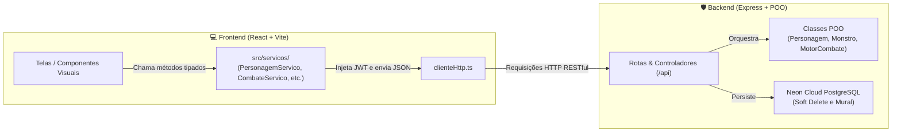

# 📋 Sprint 5: Interface Web Interativa e Integração de Serviços (React & Vite)

**Tech Lead:** Antigravity  
**Desenvolvedor Responsável:** Gabriel  
**Projeto:** *Fracture: The Vaslen Echoes*  
**Objetivo da Sprint:** Construir a interface visual interativa (Frontend Web) conectada diretamente à API RESTful desenvolvida nas Sprints anteriores. Para fins pedagógicos e de avaliação acadêmica de POO, toda a comunicação com o backend é estritamente isolada em uma camada dedicada de **Serviços / Repositórios de API** (`frontend/src/servicos/`), permitindo demonstrar com clareza como a interface visual aciona e respeita as regras de negócio do domínio (validação de 20 pontos, combate por turnos com IA, mural de caçadas anti-farm e Soft Delete).

---

## 🧭 Mensagem do Tech Lead

> Fala, Gabriel! Chegamos à reta final: a **Sprint 5 — A Materialização Visual de Vaslen**.
> 
> O nosso Backend já é uma fortaleza completa:
> 1. Domínio de POO pura validado (`src/dominio/`).
> 2. Banco de dados relacional no **Neon Cloud PostgreSQL** com Soft Delete (`src/infra/`).
> 3. API RESTful com Express, JWT e orquestração de combate (`src/api/`).
> 
> Agora, na Sprint 5, criaremos a experiência visual do jogador. E o diferencial que alinhamos é cirúrgico para a sua banca de avaliação:
> * **As telas não chamam o backend diretamente:** Elas nunca fazem requisições soltas.
> * **Camada de Serviços / Repositórios no Front:** Toda chamada HTTP é centralizada em arquivos como `PersonagemServico.ts` e `CombateServico.ts`.
> * Se o professor perguntar: *"Onde a interface interfere nas regras de POO?"*, basta abrir a pasta de serviços e mostrar as funções disparando as validações do construtor de herói e os turnos do `MotorCombate`.

---

## 🏛️ Arquitetura de Comunicação (Camada de Serviços)

---

## 🎫 Chamado 0: Setup do Frontend (Vite + React + Tailwind CSS)

* **Status:** ⚪ A Fazer (Semana que vem)
* **Prioridade:** Alta (Bloqueante)
* **Local de Execução:** Pasta `frontend/`

### 📝 Escopo:
1. Inicializar projeto Vite com template React e TypeScript.
2. Configurar o **Tailwind CSS** com paleta Dark Fantasy (ardósia profunda, carmesim, âmbar e ouro envelhecido).
3. Configurar proxy no `vite.config.ts` apontando para a API local (`http://localhost:3333/api`).

---

## 🎫 Chamado 1: Camada de Serviços e DTOs (`src/servicos/`)

* **Status:** ⚪ A Fazer
* **Prioridade:** Alta
* **Arquivos a Criar:**
  * `frontend/src/servicos/clienteHttp.ts`: Instância base com cabeçalho `Authorization: Bearer <TOKEN>`.
  * `frontend/src/servicos/AutenticacaoServico.ts`: `cadastro()`, `login()`, `obterPerfil()`, `logout()`.
  * `frontend/src/servicos/PersonagemServico.ts`: `criar()`, `listarAtivos()`, `buscarPorId()`, `distribuirPontos()`, `inativar()`.
  * `frontend/src/servicos/CodiceServico.ts`: `listar()`, `buscarPorTermo()`, `buscarPorCategoria()`.
  * `frontend/src/servicos/CombateServico.ts`: `obterMural()`, `iniciarCombate()`, `enviarTurno()`, `obterSessao()`.

---

## 🎫 Chamado 2: Telas de Autenticação e Lobby (`TelaAuth` e `TelaLobby`)

* **Status:** ⚪ A Fazer
* **Prioridade:** Alta

### 📝 Escopo:
* **Tela de Login / Cadastro:** Formulário dark com abas para alternar entre entrar e criar conta.
* **Lobby de Heróis:** Grid com cards dos personagens ativos (`ativo === true`), mostrando vida, energia, classe e nível.
* **Botão de Inativação Manual:** Diálogo de confirmação que executa o Soft Delete via `PersonagemServico.inativar(id)`.

---

## 🎫 Chamado 3: Criador de Personagens com Regra dos 20 Pontos (`TelaCriador`)

* **Status:** ⚪ A Fazer
* **Prioridade:** Alta

### 📝 Escopo:
* Seletor de classe com pré-visualização animada do sprite (Guerreiro, Mago, Arqueiro).
* **Contador Interativo dos 20 Pontos:**
  - Exibe "Pontos Restantes: X / 20".
  - Bloqueia o botão de salvar caso a soma de Força + Defesa + Agilidade seja diferente de 20 (RN01).

---

## 🎫 Chamado 4: Hub do Herói e Modal do Códice (`TelaHubHeroi` e `ModalCodice`)

* **Status:** ⚪ A Fazer
* **Prioridade:** Média

### 📝 Escopo:
* Visualização da ficha do herói selecionado, inventário de itens/poções e distribuição de pontos pós-level-up.
* Modal flutuante do Códice de Vaslen com pesquisa textual instantânea por lore, biomas e relíquias.

---

## 🎫 Chamado 5: Mural de Caçadas e Arena de Batalha 2D (`TelaMural` e `TelaArena`)

* **Status:** ⚪ A Fazer
* **Prioridade:** Alta (Módulo Principal)

### 📝 Escopo:
* **Mural de Caçadas:** Cards dos 21 monstros organizados por biomas, com indicação visual de `DISPONÍVEL` vs `ELIMINADO` (Anti-Farm).
* **Arena de Combate:**
  - Sprite do herói à esquerda e monstro à direita com animações de Idle, Ataque e Dano.
  - Barras dinâmicas de HP e Energia.
  - Botoeira tática (Ataques rápidos, pesados, defesa e itens da mochila).
  - Feed narrativo rolável em tempo real com mensagens do motor de combate.
  - Modal de Vitória (loot + XP) ou Derrota definitiva (aviso de Soft Delete).

---

## 🎫 Chamado 6: Preparação para Deploy na Vercel

* **Status:** ⚪ A Fazer
* **Prioridade:** Média

### 📝 Escopo:
* Criação do arquivo `vercel.json` para suporte a roteamento SPA.
* Configuração das variáveis de ambiente de produção conectando ao backend e Neon PostgreSQL.

---

## 🎯 Quadro de Progresso da Sprint 5

| Chamado | Descrição | Responsável | Status |
| :--- | :--- | :--- | :--- |
| **Chamado 0** | Setup Vite + React + TypeScript + Tailwind CSS | Gabriel / Antigravity | ⚪ A Fazer |
| **Chamado 1** | Camada de Serviços / Repositórios de API no Frontend | Gabriel / Antigravity | ⚪ A Fazer |
| **Chamado 2** | Telas de Autenticação e Lobby com Soft Delete | Gabriel / Antigravity | ⚪ A Fazer |
| **Chamado 3** | Criador de Personagens com validação visual dos 20 pontos | Gabriel / Antigravity | ⚪ A Fazer |
| **Chamado 4** | Hub Central do Herói e Modal de Busca do Códice | Gabriel / Antigravity | ⚪ A Fazer |
| **Chamado 5** | Mural de Caçadas Únicas e Arena de Combate 2D | Gabriel / Antigravity | ⚪ A Fazer |
| **Chamado 6** | Build de Produção e Configuração para Vercel | Gabriel / Antigravity | ⚪ A Fazer |

---

> 🏁 **Estado Atual do Projeto:**  
> Sprints 1, 2, 3 e 4 estão 100% concluídas, testadas e sincronizadas no GitHub.  
> O desenvolvimento da Sprint 5 será iniciado na próxima semana conforme cronograma definido!
